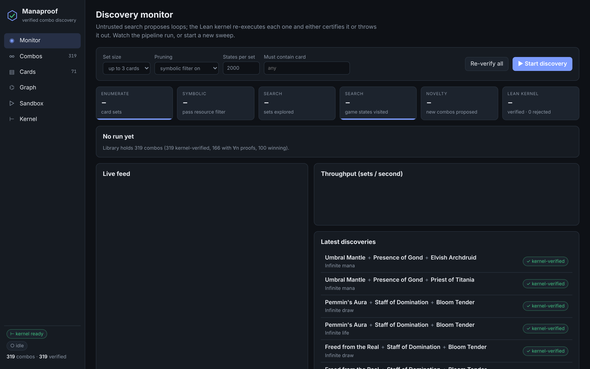
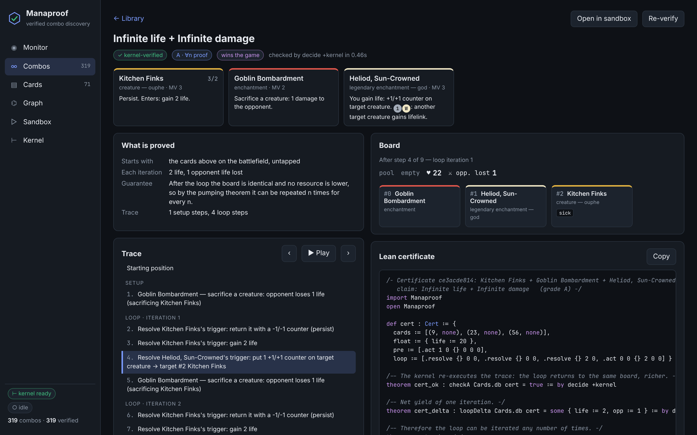

# Manaproof

**Verified combo discovery for a card game treated as a programming language.**

Cards are programs in a small typed DSL. An untrusted search engine explores what
those programs can do together and proposes infinite loops; a formal semantics
written in Lean 4 re-executes every proposal inside the kernel and either
certifies it or rejects it. A web interface lets you watch the pipeline run and
explore everything it finds.

```
 cards as programs ──► symbolic filter ──► loop search ──► certificate ──► Lean kernel
   engine/pool.py       resource graph      BFS + Karp–Miller    (trace)       decide +kernel
                        (untrusted)         acceleration                       + pumping theorem
                                            (untrusted)                        (trusted)
```

> Unofficial fan/research project. Card names are used to identify game pieces;
> all rules encodings and descriptions here are original. Not affiliated with or
> endorsed by Wizards of the Coast.





## Quick start

```bash
cd manaproof
./scripts/install_lean.sh      # once: installs Lean 4 via elan and builds the kernel
./run.sh                       # http://127.0.0.1:8642
./run.sh --discover 3          # …and start a sweep over all 2- and 3-card sets
python3 -m unittest tests.test_engine
```

Python 3.9+ with no third-party packages. Without Lean the app still runs, but
combos are labelled *unverified*. A snapshot of a full sweep is committed in
`data/store.json`, so the UI has a library to explore on first launch.

## The web interface

| Tab | What it is for |
|---|---|
| **Monitor** | Start/stop sweeps (set size, pruning on/off, state budget, “must contain card”). Live funnel — enumerated → symbolic pass → searched → proposed → kernel-verified/rejected — plus throughput and an event feed, streamed over SSE. |
| **Combos** | The library. Filter by outcome, size, proof grade, kernel status. Each combo has a step-by-step trace player with the board after every action, the plain-language guarantee, and the exact Lean certificate that was checked. |
| **Cards** | Every card's program, its symbolic signature, its Lean term, and the combos it appears in. |
| **Graph** | Cards as nodes; edges are verified combos or symbolic resource flows. |
| **Sandbox** | Put any cards on the battlefield and drive the interpreter by hand. The engine lists every legal action and flags the moment your line closes a loop. Or ask it to search that exact set. |
| **Kernel** | The Lean sources, the theorems, the toolchain state and the trust model. |

## What is actually proved

The kernel (`lean/Manaproof/`, ~750 lines, no dependencies beyond core Lean) defines:

* `Model.lean` — the card language: costs, effects, triggers, keywords, grants.
* `Step.lean` — a small-step semantics: activated abilities, a LIFO stack of
  triggered abilities, state-based actions (lethal toughness, counter
  annihilation, orphaned Auras, the legend rule), summoning sickness, tokens,
  persist/undying, attachments, cost reduction and replacement of -1/-1 counters.
  One action is one transition, so the interpreter is step-indexed by
  construction — mandatory loops that never end are just infinite action lists.
* `Theorems.lean` — the metatheory:
  * `step_shift`: resources are a *frame* — adding mana/life never disables a
    transition and is carried through unchanged.
  * `pump`: if a trace returns to the **same board** with no resource lower, it
    can be repeated *n* times for every *n*, gaining exactly *n*× the net yield.
  * `checkA_sound`: a certificate that passes the executable checker really
    does denote an unbounded loop.

Each discovered combo becomes a Lean file whose theorems are discharged by
`decide +kernel` — plain kernel reduction, no `native_decide`, no trusted
compiler. Two grades:

* **A — inductive.** The loop returns to an identical board; `checkA_sound`
  gives a statement for all *n*.
* **B — bounded.** The board itself grows (tokens, counters), so it never
  repeats. The kernel checks six consecutive iterations by evaluation. This is
  a weaker guarantee and is labelled as such everywhere.

The design choice that makes this cheap: `stepCfg` is a pure function of the
board that *returns* a cost vector and a yield vector and never inspects the
resource pool. The frame property then has a ten-line proof that does not
depend on how complicated the rules get.

### Trusted base

Lean's kernel, the semantics in `Step.lean`, and the card encodings in
`Cards.lean` (generated from `engine/pool.py`). A wrong card encoding gives a
true theorem about the wrong card — the translation from printed card to DSL is
checked by reading it, by the regression tests, and by nothing else.

Everything else is untrusted: the Python engine, the symbolic filter, the
search, the UI. The Python engine is a transliteration of `Step.lean`; because
every certificate is replayed by the kernel, any divergence between the two
shows up as a **rejected** certificate (differential testing for free).

## How discovery works

1. **Symbolic filter** (`engine/symbolic.py`). Each card is abstracted to the
   resources it produces and needs (mana, untaps, creatures, deaths, ETBs, life,
   counters …). A set is searched only if that resource graph is connected and
   contains a cycle. On this pool it discards 54% of three-card sets; in a
   5,000-set sample of what it discarded, none contained a new combo.
2. **Search** (`engine/search.py`). Breadth-first over the goldfish game tree
   from “these cards on the battlefield”, first with an empty mana pool, then
   with some mana floating (later minimised). A loop is a path that revisits a
   board with more resources. Borrowing from Karp–Miller coverability trees,
   when a resource loop is found the search *accelerates* — jumps to a state
   where it has run several times — which is how a mana engine gets connected
   to the payoff that spends the mana.
3. **Novelty.** A set is reported only for outcomes that none of its proper
   subsets already achieve, so a third card must unlock something new.
4. **Verification** (`engine/leangen.py`). The certificate is rendered to Lean
   and checked.

## Results on the bundled pool

71 hand-encoded cards (plus 6 token definitions). The committed snapshot
(`data/store.json`) is a full sweep of all 2- and 3-card sets, about nine
minutes on four cores:

| | |
|---|---|
| Card sets enumerated | 59,640 |
| Passed the symbolic filter | 27,237 |
| Game states explored | 10.1 million |
| Combos proposed (new outcome vs. every subset) | 319 — 18 two-card, 301 three-card |
| Verified by the Lean kernel (`decide +kernel`) | 319 |
| Rejected by the kernel | 0 |
| Grade A (∀n proof) / grade B (bounded) | 166 / 153 |
| Win the game outright (damage or mill) | 100 |

Two real modelling bugs were caught on the way to that zero — a missing legend
rule and a card returning twice when two triggers raced to reanimate it — both
found by auditing surprising output, which is the workflow the UI is built for.

It rediscovers
the classics unprompted (Devoted Druid + Vizier of Remedies, Kiki-Jiki + any
untapper, Heliod + Walking Ballista, Felidar Guardian + Saheeli Rai, persist +
Vizier/Melira + a sacrifice outlet, Nim Deathmantle + Composite Golem …) and
also finds less obvious lines, e.g. Devoted Druid killing itself with its own
counters under Mikaeus's undying to fuel enters-the-battlefield payoffs.

## Simplifications (read before trusting a result)

The model is a *fragment* of the game, chosen to make loops expressible:

* One player, one turn, no opponent interaction, no hidden zones: no hand,
  library or casting. All combo pieces start on the battlefield, untapped and
  not summoning-sick. “Setup mana” is mana assumed to be floating.
* No lands, no combat, no damage to creatures, no power (only toughness).
* When several triggers fire at once they are stacked in a fixed order; where
  the real game gives a choice (legend rule, trigger order, which copy to keep)
  the model picks one legal option. Sound for existence claims, incomplete for
  search.
* Activated abilities resolve immediately; only triggers use the stack.
* “Or” in card text is encoded as several abilities or narrowed to one case;
  each card's `text` in the Cards tab states exactly what is modelled.
* Grade-B certificates repeat a *fixed* action list, so growing loops whose
  actions must name a different permanent each time (e.g. a fresh token untaps
  the copier) are not expressible; such pairs usually still surface as
  grade-A triples with a sacrifice outlet.
* Mana of restricted use, hybrid costs, and “until end of turn” durations are
  treated as unrestricted / colour-pair / permanent-for-the-turn.

Magic is Turing-complete (Churchill, Biderman & Herrick, 2019), so no tool can
decide every game state. This one never claims to: it reports loops it can
exhibit and stays silent otherwise.

## Adding a card

Write it in `engine/pool.py` using the builders in `engine/dsl.py`:

```python
card("Devoted Druid", "creature", "G", 2, (0, 2), "elf druid",
     ab=[act(T, mana("G")), act(cost(putNeg=1), UNTAP_SELF)],
     text="Tap: add G. Put a -1/-1 counter on it: untap it.")
```

Restart the server: `Cards.lean` is regenerated, the kernel is rebuilt, and the
card is available to search, the sandbox and the graph. New *mechanics* need a
constructor in `Model.lean`, a case in `Step.lean`, and the mirror case in
`engine/model.py`; `pump` does not need to be touched as long as the new rule
does not read the resource pool.

## Where this goes next

* Import card definitions from an existing rules engine or Oracle-text compiler
  and differentially test encodings against it.
* Zones and casting, so certificates start from a hand and a mana base and
  “turn-N win” becomes a searchable objective.
* An inductive theorem for growing boards (a simulation relation that ignores
  inert extra permanents) to lift grade B to grade A.
* SMT-backed loop synthesis over the resource abstraction; an opponent and
  interaction for deck- and strategy-level search.
